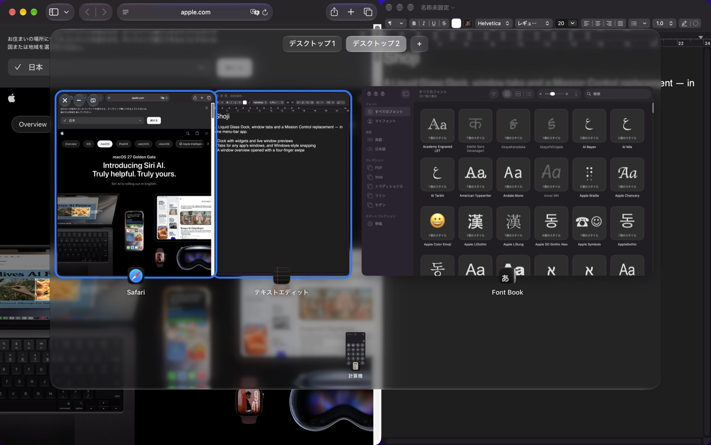
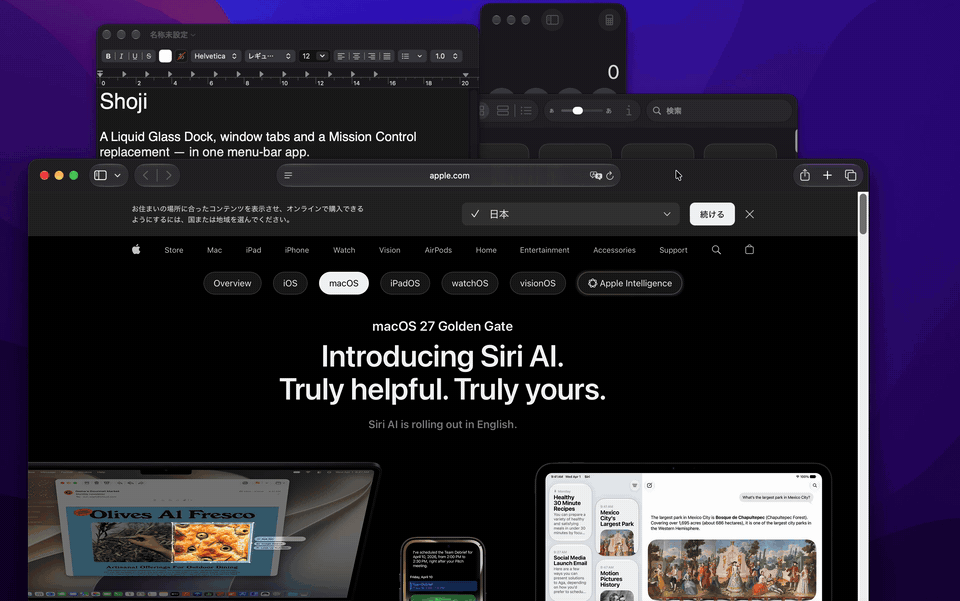
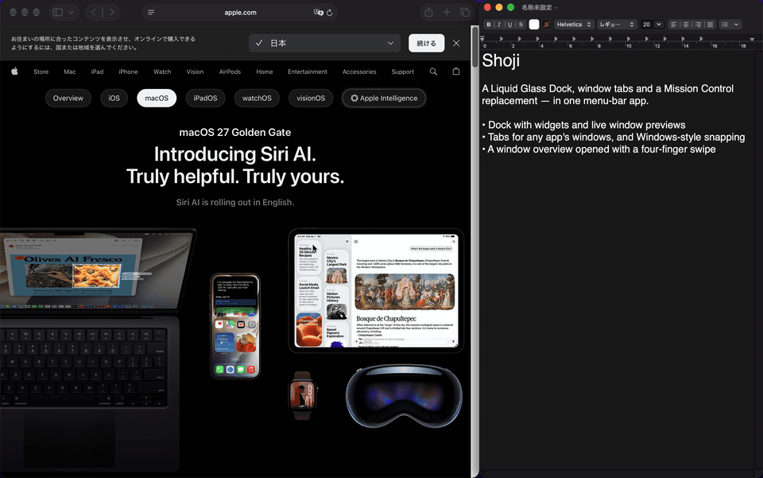
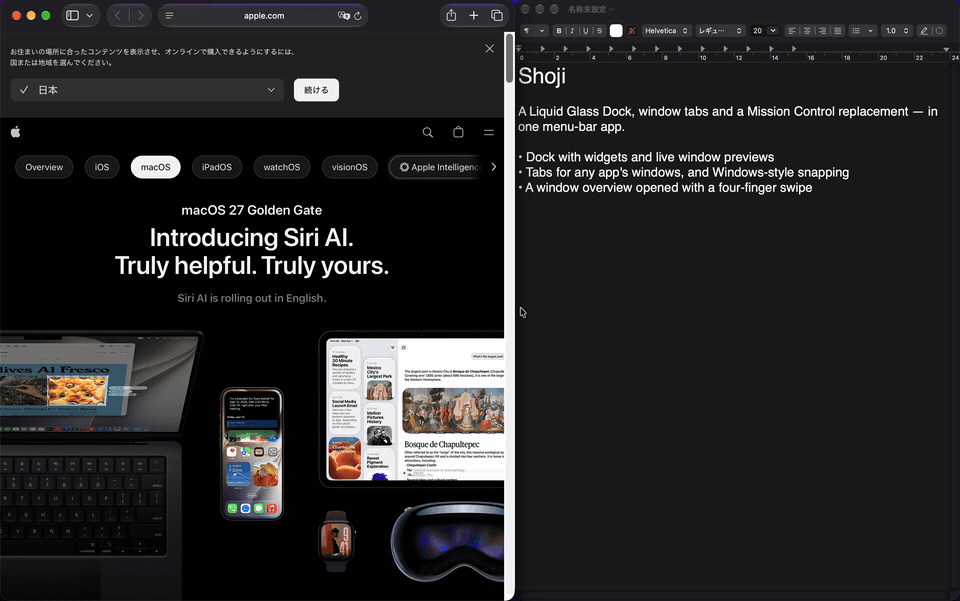
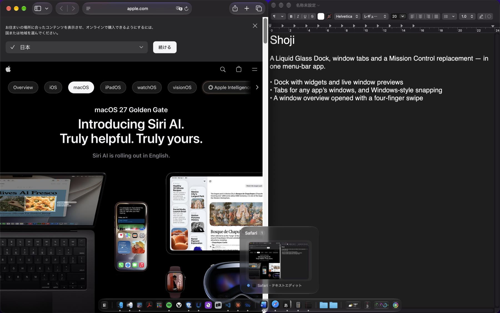
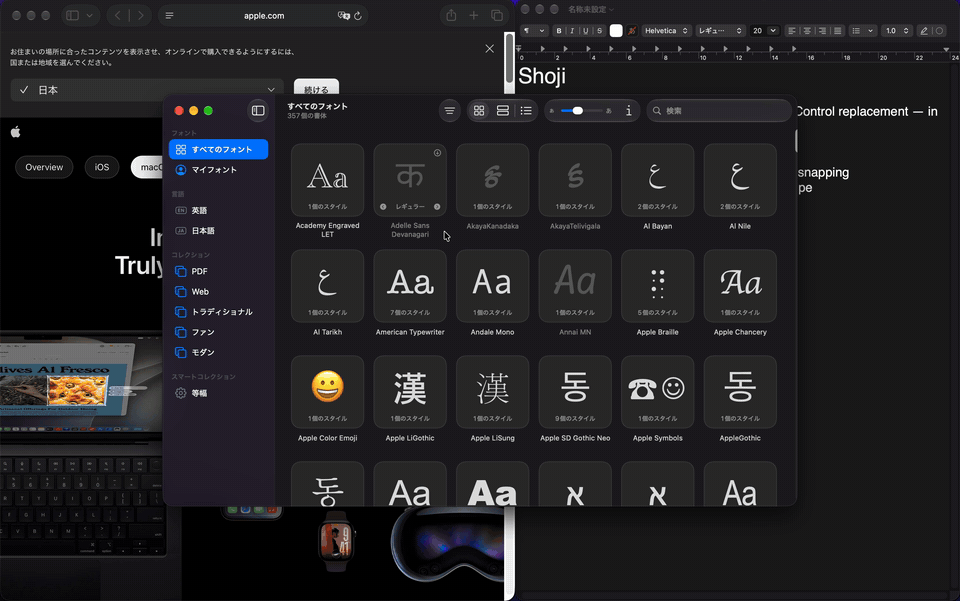

# Shoji

[English](README.md)

[GlassDock](https://github.com/Ryuto42/GlassDock)・[ShelfTabs](https://github.com/Ryuto42/ShelfTabs)・[MissionView](https://github.com/Ryuto42/MissionView) を 1 つにまとめた、macOS 26 以降のメニューバー常駐アプリです。Liquid Glass の Dock、どのアプリでも使えるタブと Windows のような分割表示、Mission Control の代わりのウィンドウ一覧をまとめて使えます。



## 入っている機能

| | 機能 | 元のアプリ |
|---|---|---|
| Dock | 25 種類のウィジェット、ウィンドウのライブプレビュー、Option+Tab の切り替えを備えた Liquid Glass の Dock | [GlassDock](https://github.com/Ryuto42/GlassDock) |
| タブとスナップ | どのアプリのウィンドウもタブにまとめ、画面の端や角にスナップ | [ShelfTabs](https://github.com/Ryuto42/ShelfTabs) |
| ウィンドウ一覧 | すべてのウィンドウとデスクトップを一覧で表示。4本指のスワイプか Option+Tab で開く | [MissionView](https://github.com/Ryuto42/MissionView) |

各機能は単体アプリとしても使えます。Shoji にすると、メニューバーのアイコンと設定画面が 1 つになり、次のように機能どうしが連携します。

## 連携してできること

### Windows のような分割表示

ウィンドウを画面の左右の端へドラッグするとスナップします。空いた側には残りのウィンドウが並ぶので、選ぶとそこを埋めます。



2 枚の境目をドラッグすると、両方の大きさが一緒に変わります。組は組のまま扱われ、ウィンドウ一覧と Dock では 1 つのまとまりとして表示します。片方を最小化・復元すると、もう片方も一緒に最小化・復元します。



### ウィンドウとデスクトップの一覧

4本指で上へスワイプすると、すべてのウィンドウをアプリごとに並べ、分割表示の組はまとめて表示します。カードに乗せると閉じる・最小化・分割を外すボタンが出ます。カードを別のカードの左右半分に重ねると分割表示に、上部のデスクトップへドラッグするとそのデスクトップへ移せます。ウィンドウを画面の上端で止めると、そのウィンドウを持ったまま一覧が開きます。



### 分割表示に対応した Dock のプレビュー

Dock のライブプレビューでも分割表示の組は 1 枚のカードになり、クリックすると 2 枚とも前面に出ます。



### どのアプリでも使えるタブ

ウィンドウを別のウィンドウの左上へドラッグするとタブにまとまります。信号ボタンの上の小さなボタンに乗せると切り替えられます。



ほかにも、最小化した順（新しいものが左）・サムネイル・本物のウィンドウとポップアップの区別を Dock と一覧で共有します。4本指で下へスワイプすると、使っているウィンドウを分割表示の相方ごと最小化します。

## インストール

macOS 26 Tahoe 以降（Apple シリコン・Intel）が必要です。

1. [Releases](https://github.com/Ryuto42/Shoji/releases) から `Shoji-x.y.z.zip` をダウンロードして展開し、`Shoji.app` を `/Applications` に移動します。
2. 公証されていないリリースは初回起動がブロックされます。一度 `Shoji.app` を開いてから、システム設定 → プライバシーとセキュリティで「このまま開く」を押してください。ターミナルで次を実行しても構いません。

   ```sh
   xattr -dr com.apple.quarantine /Applications/Shoji.app
   ```

3. 求められたら、下の権限を許可します。初回起動時に単体アプリの設定を引き継ぎます。

アップデートは [Sparkle](https://sparkle-project.org) で配信し、EdDSA 署名を検証してから適用します。

Shoji が異常終了したときは自動で起動し直します。続けて落ちる（3 分以内に 3 回）ときは安全モードで起動し、機能を止めて標準の Dock とタブの裏に隠したウィンドウを元に戻すので、Shoji を入れていないときと同じように使えます。メニューから Shoji を終了したときも標準の Dock に戻します。

### 単体アプリと一緒に使う

GlassDock・ShelfTabs・MissionView を入れたままでも使えます。単体アプリが起動しているあいだは、Shoji の同じ機能を止めて Dock・ジェスチャー・ウィンドウの取り合いを避け、単体アプリを終了すると Shoji で再開します。すべて Shoji に任せたいときは、単体アプリの「ログイン時に起動」をオフにしてください。

Dock のウィンドウ切り替えとウィンドウ一覧はどちらも Option+Tab を使うので、同時にはどちらか一方だけが動きます。設定で選べます。

## 権限

| 権限 | 使う機能 |
|---|---|
| アクセシビリティ（必須） | ウィンドウの読み取り・移動・前面化、トラックパッドのジェスチャー・ショートカット・ドラッグ |
| 画面収録（必須） | ウィンドウのサムネイル、ライブプレビュー、一覧の背景 |
| 入力監視 | ショートカットとウィンドウのドラッグを見るために、macOS が求めることがあります |
| オートメーション | 使ったときだけ：Spotify とミュージックの操作、ゴミ箱を空にする、ダークモードの切り替え |
| カレンダー・リマインダー | そのウィジェットを置いたときだけ |
| 位置情報 | 天気ウィジェットで現在地を使うときだけ |
| ダウンロードフォルダ | Dock にダウンロードフォルダを置いたときだけ |

## プライバシー

分析や利用状況の送信は一切行いません。通信するのは、Sparkle のアップデート確認（GitHub）、天気ウィジェットの [Open-Meteo](https://open-meteo.com) と Apple の地図検索、再生中の曲の Spotify のアートワークの取得だけです。サムネイルはメモリ上にだけ保持します。設定は UserDefaults（`com.ryuto.Shoji`）に保存します。

ウィンドウの読み取りやデスクトップ間の移動に、macOS の非公開 API（SkyLight と `_AXUIElementGetWindow` など。4本指のジェスチャーには MultitouchSupport）を使っています。macOS のアップデートで動かなくなる可能性があり、Mac App Store では配布できません。詳しくは各リポジトリを参照してください。

## アンインストール

1. 「ログイン時に起動」がオンなら先にオフにし、メニューバーのアイコンから Shoji を終了します（標準の Dock は自動で元に戻ります）。
2. `/Applications/Shoji.app` を削除します。
3. 設定も消すときは `defaults delete com.ryuto.Shoji` を実行します。

強制終了などで標準の Dock が隠れたままになったときは、Shoji を一度起動して終了するか、次を実行してください。

```sh
defaults delete com.apple.dock autohide-delay; defaults delete com.apple.dock no-bouncing; killall Dock
```

## ビルド

Xcode 26（Swift 6.2）が必要です。

```sh
./build.sh          # build/Shoji.app
./build.sh install  # /Applications にインストールして起動
```

このリポジトリの隣に `GlassDock`・`ShelfTabs`・`MissionView` があればそれを直接使い、なければ `Package.swift` に書かれた公開済みのバージョンを GitHub から取得します。署名用の証明書がなければアドホック署名になり、ビルドのたびにアクセシビリティの許可が外れます。

### リリース（メンテナー向け）

4 つのリポジトリはここからまとめてリリースします。

1. 変更のあったリポジトリの `CHANGELOG.md` の先頭に `## X.Y.Z` の節を書く
2. `scripts/update.sh` がリリースの要否を判定し、`Package.swift` を新しいバージョンに合わせ、各 `dist/` に zip と `appcast.xml` を作る
3. `scripts/publish.sh` が、各機能 → Shoji の順にコミット・タグ・push・GitHub リリースを行う

## ライセンス

[GPL-3.0](LICENSE) © 2026 Ryuto Kobayashi。GlassDock は GPL-3.0、ShelfTabs と MissionView は MIT です。同梱している第三者のコード（Sparkle、ShelfTabs の一部に使っている Origami 由来の実装）は [THIRD_PARTY_NOTICES.md](THIRD_PARTY_NOTICES.md) にまとめています。
