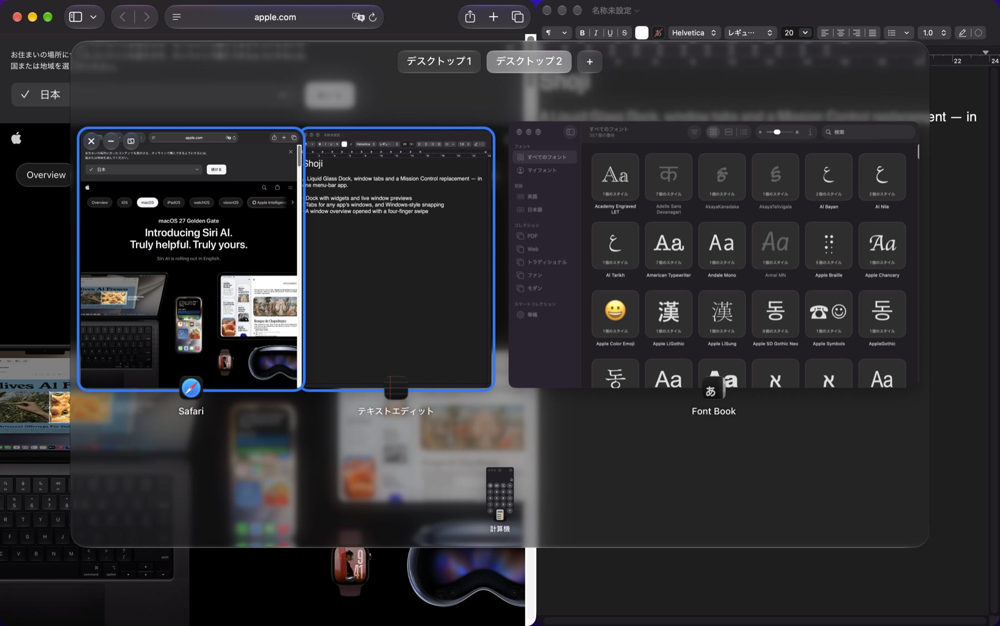
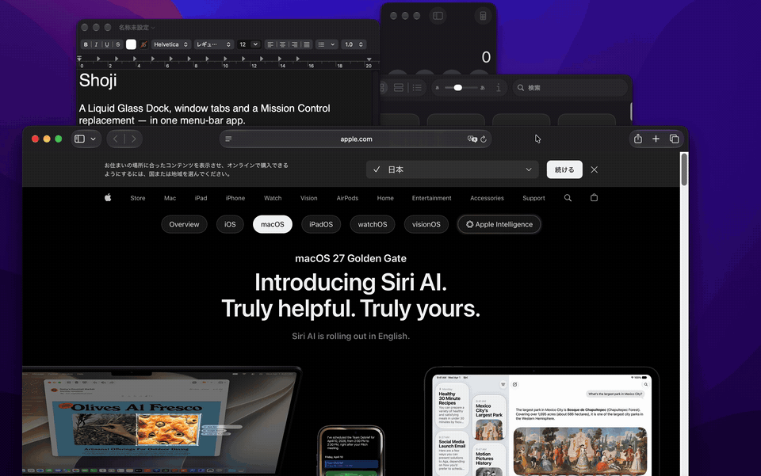
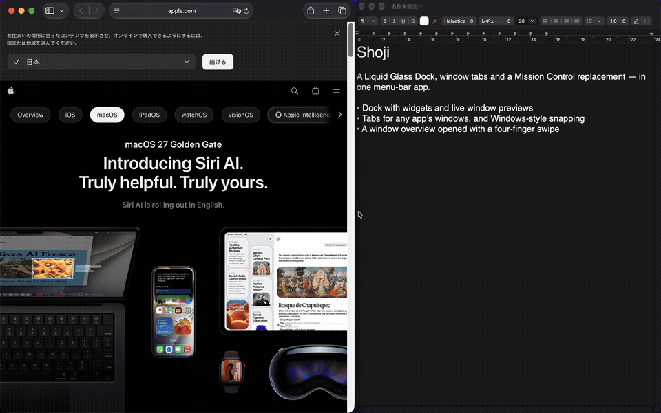
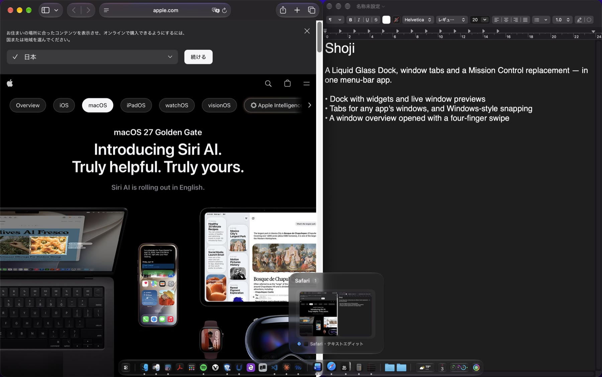
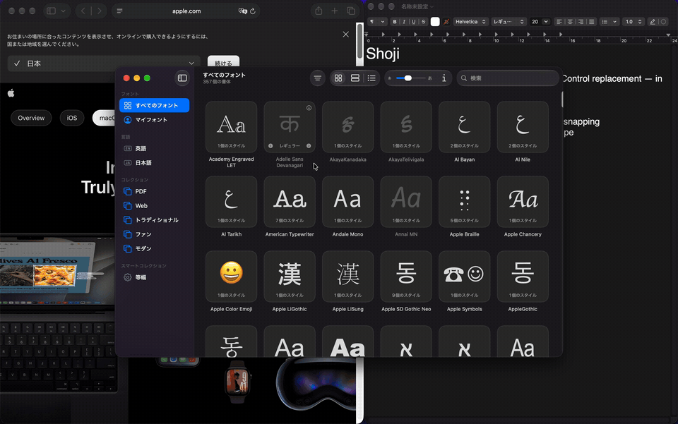

# Shoji

[日本語](README.ja.md)

A menu-bar app for macOS 26 and later that runs [GlassDock](https://github.com/Ryuto42/GlassDock), [ShelfTabs](https://github.com/Ryuto42/ShelfTabs) and [MissionView](https://github.com/Ryuto42/MissionView) together as one app — a Liquid Glass Dock, tabs and Windows-style snapping for any app, and a Mission Control replacement.



## What's inside

| | Feature | From |
|---|---|---|
| Dock | Liquid Glass Dock with 25 widgets, live window previews and an Option+Tab window switcher | [GlassDock](https://github.com/Ryuto42/GlassDock) |
| Tabs and snapping | Group the windows of any app into tabs; snap windows to screen edges and corners | [ShelfTabs](https://github.com/Ryuto42/ShelfTabs) |
| Window overview | Every window and desktop at a glance, opened with a four-finger swipe or Option+Tab | [MissionView](https://github.com/Ryuto42/MissionView) |

Each feature is also available as its own app. Shoji adds one menu-bar icon, one settings window, and the integrations below.

## Working together

### Split views, like Windows

Drag a window to the left or right edge to snap it. The other half of the screen shows your remaining windows — pick one to fill it.



Drag the edge between the two windows to resize both at once. The pair stays a pair: it is shown as one tile in the overview and the Dock, and minimizing or restoring one window minimizes or restores both.


### One overview for windows and desktops

Swipe up with four fingers to see every window, grouped by app, with split-view pairs kept together. Hover a card for close, minimize and unsplit buttons; drop a card onto half of another card to split them; drag a window to a desktop at the top to move it. Holding a window at the top edge of the screen opens the overview with the window still in your hand.



### Dock previews that know about splits

The Dock's live previews show a split-view pair as one card, and clicking it brings both windows back.



### Tabs for any app

Drag a window onto the top-left corner of another window to merge them into tabs. Hover the small button above the traffic lights to switch.



Also shared between the Dock and the overview: the order windows were minimized in (newest first), thumbnails, and which windows are popups rather than real windows. A four-finger swipe down minimizes the window you are using — together with its split-view partner.

## Install

Requires macOS 26 Tahoe or later (Apple silicon and Intel).

1. Download `Shoji-x.y.z.zip` from [Releases](https://github.com/Ryuto42/Shoji/releases), unzip it, and move `Shoji.app` to `/Applications`.
2. If the release is not notarized, macOS blocks the first launch. Open `Shoji.app` once, then go to System Settings > Privacy & Security and click "Open Anyway". Alternatively, run:

   ```sh
   xattr -dr com.apple.quarantine /Applications/Shoji.app
   ```

3. Grant the permissions below when asked. Settings from the standalone apps are imported on first launch.

Updates are delivered with [Sparkle](https://sparkle-project.org) and verified with an EdDSA signature before they are applied.

If Shoji quits unexpectedly, it is started again automatically. If it keeps crashing (three times within three minutes), it starts in safe mode: the features stay off and the standard Dock and any windows hidden behind tabs are put back, so your Mac works as if Shoji were not installed. Quitting Shoji from its menu also restores the standard Dock.

### Using it alongside the standalone apps

You can keep GlassDock, ShelfTabs or MissionView installed. While a standalone app is running, Shoji pauses the same feature so the two never fight over the Dock, gestures or windows, and picks it up again when the standalone app quits. If you want Shoji to handle everything, turn off "Launch at login" in the standalone apps.

The Dock's window switcher and the overview both use Option+Tab, so only one of them can have it; choose which in Settings.

## Permissions

| Permission | Needed for |
|---|---|
| Accessibility (required) | Reading, moving and raising windows; trackpad gestures, shortcuts and drags |
| Screen Recording (required) | Window thumbnails, live previews and the screen behind the overview |
| Input Monitoring | macOS may ask for it so shortcuts and window drags can be watched |
| Automation | Only when used: controlling Spotify and Music, emptying the Trash, switching dark mode |
| Calendars, Reminders | Only when you add the Calendar or Reminders widget |
| Location | Only for the Weather widget's current location |
| Downloads folder | Only for the Downloads folder in the Dock |

## Privacy

Shoji has no analytics and sends nothing about you. Network access is limited to the Sparkle update check (GitHub), weather from [Open-Meteo](https://open-meteo.com) and place search through Apple's map service for the Weather widget, and Spotify artwork for the song that is playing. Thumbnails are kept in memory. Settings are stored in UserDefaults (`com.ryuto.Shoji`).

Shoji uses private macOS APIs (SkyLight and `_AXUIElementGetWindow` to read and move windows across desktops, MultitouchSupport for the four-finger gestures). They may stop working after a macOS update, and the app cannot be distributed on the Mac App Store. See each repository for the full list.

## Uninstall

1. Quit Shoji from its menu-bar icon (the standard Dock is restored automatically) and turn off "Launch at login" first if it is on.
2. Delete `/Applications/Shoji.app`.
3. Optionally remove the settings with `defaults delete com.ryuto.Shoji`.

If the standard Dock stays hidden after a crash, launch and quit Shoji once, or run:

```sh
defaults delete com.apple.dock autohide-delay; defaults delete com.apple.dock no-bouncing; killall Dock
```

## Build

Requires Xcode 26 (Swift 6.2).

```sh
./build.sh          # build/Shoji.app
./build.sh install  # install to /Applications and launch
```

If `GlassDock`, `ShelfTabs` and `MissionView` are checked out next to this repository, they are used directly; otherwise the released versions listed in `Package.swift` are fetched from GitHub. Without a signing certificate the app is signed ad hoc, which resets the Accessibility permission on every build.

### Releasing (maintainers)

The four repositories are released together from here:

1. Add a `## X.Y.Z` section at the top of `CHANGELOG.md` in each repository that changed.
2. `scripts/update.sh` checks which repositories need a release, points `Package.swift` at the new versions, and builds the zips and `appcast.xml` files into each `dist/`.
3. `scripts/publish.sh` commits, tags, pushes and creates the GitHub releases in order (features first, Shoji last).

## License

[GPL-3.0](LICENSE) © 2026 Ryuto Kobayashi. GlassDock is GPL-3.0; ShelfTabs and MissionView are MIT. Third-party code (Sparkle, and parts of ShelfTabs adapted from Origami) is listed in [THIRD_PARTY_NOTICES.md](THIRD_PARTY_NOTICES.md).
